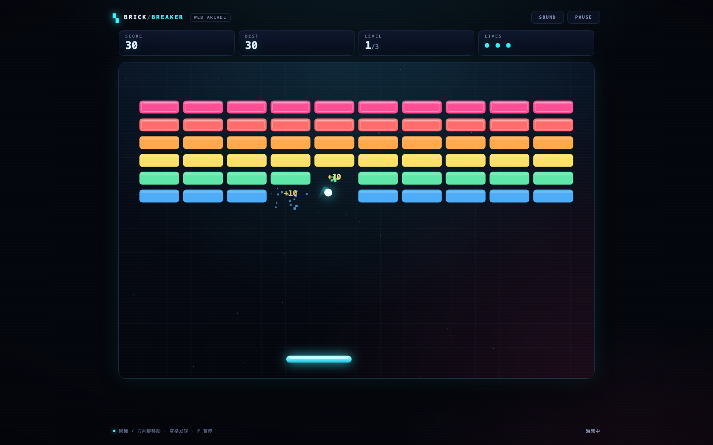

# 打砖块 · Brick Breaker

原 `test2` 练习仓库现已改造成一个**纯前端的网页版打砖块游戏**：无第三方依赖、无构建步骤，直接由静态服务器或原来的 Eclipse/Tomcat 工程托管。



## 玩法

- 移动挡板接住小球，打碎场上所有砖块；共 3 关，球速逐关提升。
- 普通彩色砖 1 击打碎，带描边的砖需要 2 击；每块砖 10 / 20 分。
- 初始 3 条命，漏接扣 1 条；清空一关获得 100 × 关卡数的过关奖励。
- 3 关全部通关后显示最终得分；最高分保存在浏览器 `localStorage`。
- 支持暂停、静音；`prefers-reduced-motion` 下减少粒子与震屏。

## 运行

游戏是静态页面，不需要启动 Java 服务。

### 方式一：任意静态服务器（推荐）

```bash
python3 -m http.server 8000 --directory WebContent
```

浏览器打开 <http://localhost:8000/>。

### 方式二：Eclipse / Tomcat

1. Eclipse：`File → Import → General → Existing Projects into Workspace`，选择仓库根目录（工程名 `test2`）。
2. 部署到支持 Servlet 3.0 的容器（如 Tomcat 7+），访问 `http://localhost:8080/test2/`。

`WebContent/` 下的资源会部署到 `/test2` 上下文根；Java 1.7 / Servlet 3.0 的工程配置保持原样，但游戏本身不需要 Java 代码。

## 操作

| 操作 | 鼠标 / 触屏 | 键盘 |
| --- | --- | --- |
| 移动挡板 | 移动鼠标 / 拖动 | ← → 或 A D |
| 发球 | 点击画面 | 空格 |
| 暂停 / 继续 | 右上角 PAUSE | P 或 Esc |
| 静音 | 右上角 SOUND | M |

## 项目结构

```text
WebContent/
├── index.html          # 页面结构、HUD、开始/暂停/结算面板
├── css/game.css        # 深色街机主题、响应式布局
└── js/game.js          # Canvas 渲染、120 Hz 固定步进物理、输入、音效
docs/screenshots/       # README / PR 用运行截图
```

## 实现说明

- 逻辑分辨率固定为 960 × 640（3:2），按 `devicePixelRatio` 设置画布分辨率，CSS 负责缩放。
- 物理以 1/120 秒固定步长推进，球与墙壁、挡板、砖块做圆-矩形碰撞；挡板反弹角度由击球位置决定。
- 无外部字体、图片或 JS 依赖，可离线运行。

## 历史

本仓库最初是一个空的 Eclipse Java Web 练习工程（`Test.java` 示例类、`App.java` 空包声明）。本次改造保留原有工程元数据，只替换了 `WebContent` 中的静态内容并更新了本 README。
